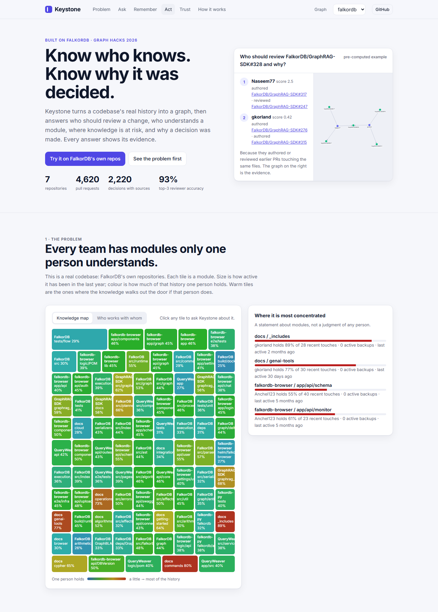
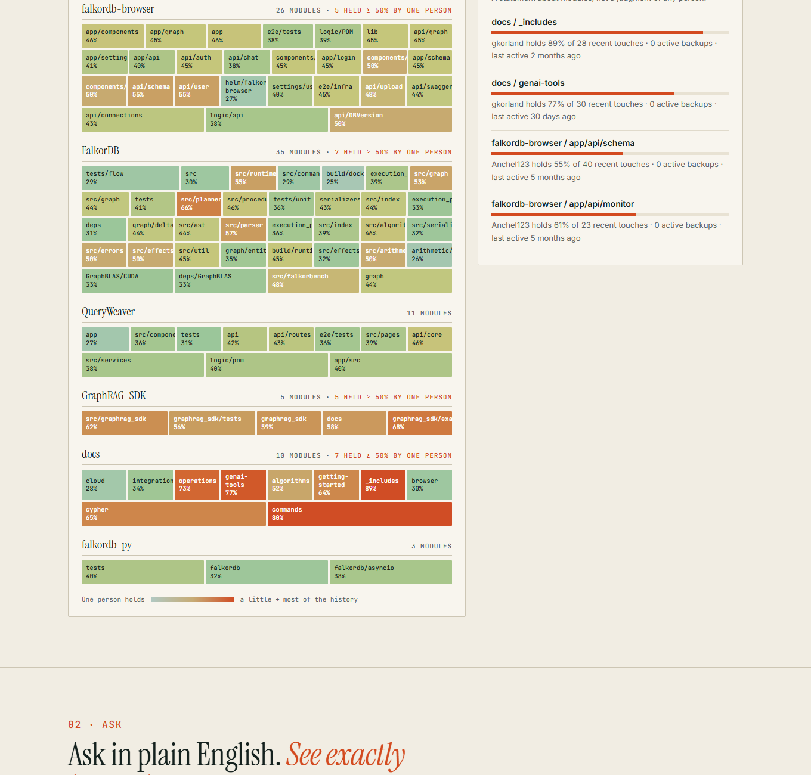
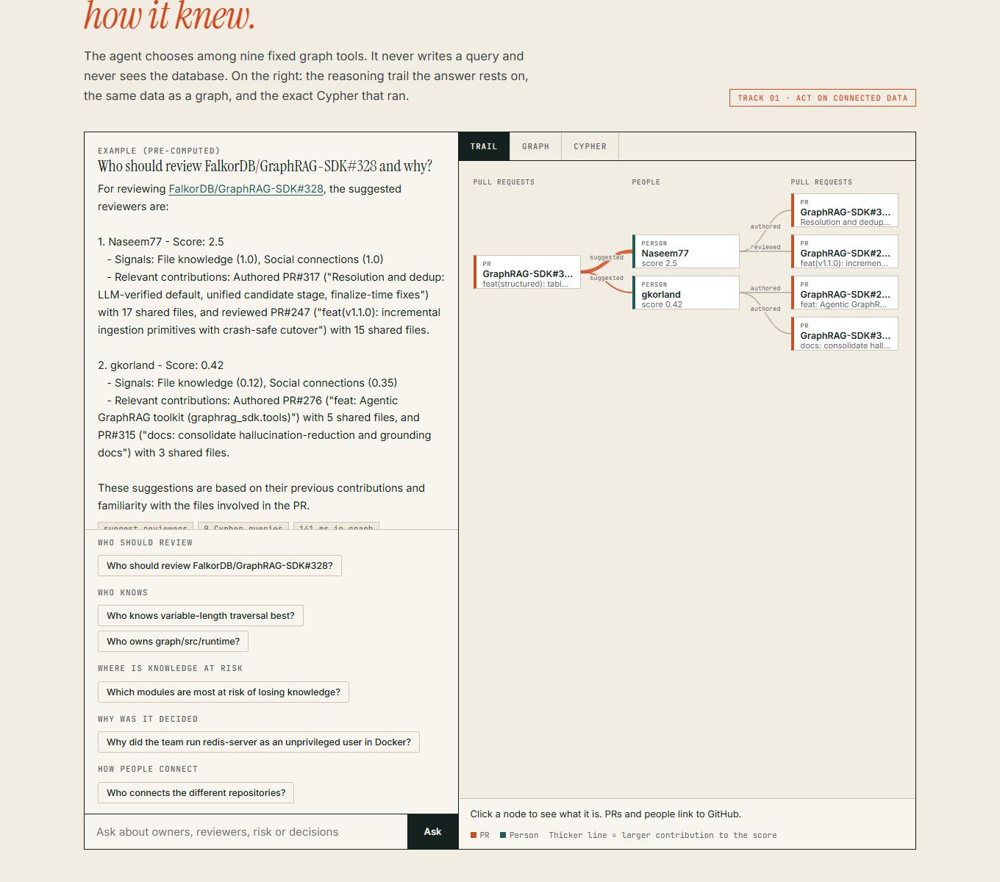
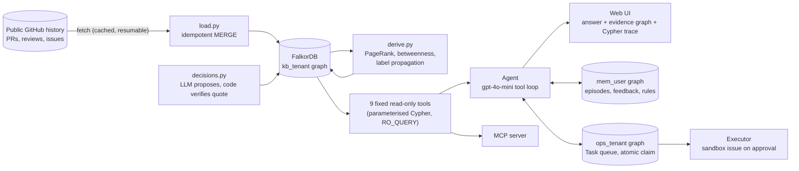
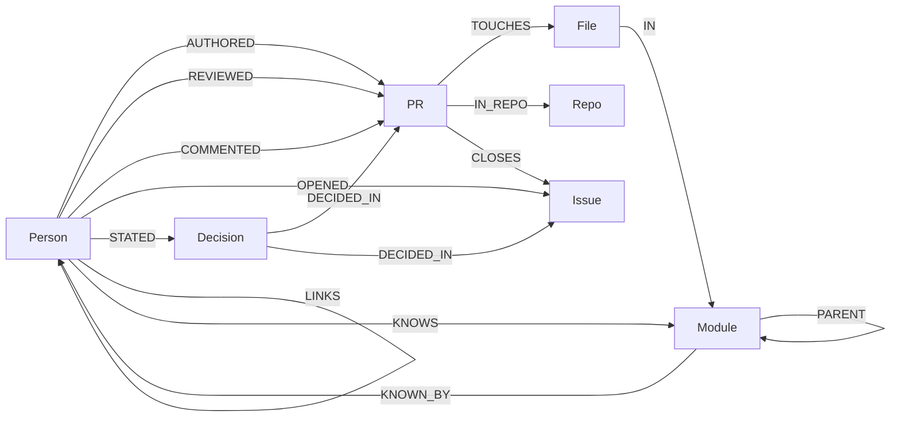

# Keystone

**Who knows what, and why it was decided. Every answer carries its evidence.**

Keystone turns the public history of a codebase (pull requests, reviews, issues, discussions) into a FalkorDB graph, then puts an agent on top that can answer *"who should review this?"*, *"who actually understands this module?"*, *"which modules would lose knowledge if one person left?"* and *"why did we decide that?"*. Each answer shows the subgraph and the exact Cypher behind it, and every quoted decision is checked against its source text by code before it is shown.







Built for **Graph Hacks: Context for AI Agents** (WeMakeDevs x FalkorDB), Oct 15-18 2026.
Tracks entered: **1 Agents That Act on Connected Data, 2 Agent Memory and Coordination, 3 Company Brain**.

* Live demo: https://keystone-graph.vercel.app (FalkorDB Cloud + Vercel)
* Demo video: _(filled in at submission)_
* A real action taken by the agent after human approval: https://github.com/srinjoy356/keystone-sandbox/issues/1
* Blog post: _(filled in at submission)_

## Architecture



| Track | Where it is satisfied |
|---|---|
| **1. Agents That Act on Connected Data** | Multi-hop reviewer scoring, graph algorithms (PageRank, betweenness, shortest path) as agent tools, MCP server for tool selection by any client, evidence subgraph and Cypher for every answer, an approved recommendation becomes a real issue in a sandbox repo |
| **2. Agent Memory and Coordination** | Working memory (last turns), episodic memory (past questions linked to entities), semantic memory (accept/reject feedback), procedural memory (expiring `AVOID` rules, also written in plain English), one graph per user, a two-agent task queue with an atomic claim tested under 12 racing threads |
| **3. Company Brain** | People, teams, modules, PRs and issues in one graph; ownership and knowledge-risk per module; decisions traced to the PR or issue thread with verified verbatim quotes and a dated list of related decisions; topic questions answered by vector recall then graph expansion |

## Why a graph, and why FalkorDB

The question "who should review this PR" is a multi-hop question: PR -> files -> directories -> every earlier PR in those directories -> the people who authored or reviewed them, weighted by how recently, plus who has reviewed this author before. A similarity search over text cannot answer it; a graph traversal answers it in tens of milliseconds. Remove FalkorDB and the product has nothing to run on: scoring, risk, communities, decision tracing and agent memory are all Cypher or FalkorDB procedures.

| Capability | What FalkorDB does |
|---|---|
| Reviewer and expert scoring | Variable-length traversal over `PARENT*0..3` module hierarchy, `exp()` recency decay, time-travel with `$asof` |
| Knowledge-risk map | Aggregation per module of who touched it in the last 12 months |
| Bridge people, teams | `algo.betweenness`, `algo.labelPropagation`, `algo.pageRank` on the author->reviewer graph |
| "How are A and B connected" | `shortestPath` over `KNOWS / KNOWN_BY / LINKS` |
| Why was it decided | Vector index on `Decision.emb` and `PR.emb`, then graph expansion to sources and people (hybrid retrieval) |
| Per-user memory | One named graph per user (`mem_<user>`), structural isolation |
| Per-tenant knowledge | One named graph per tenant (`kb_<tenant>`) |
| Agent coordination | Task nodes in `ops_<tenant>`, claimed by a single atomic write query |

## Graph data model



* **Source layer** (loaded by `keystone/load.py`, idempotent `MERGE`): `Person, PR, Issue, File, Module, Repo`.
* **Derived layer** (`keystone/derive.py`): `COLLAB` (author -> reviewer, weighted), `KNOWS`/`KNOWN_BY`/`LINKS` (directed on purpose, FalkorDB `shortestPath` is directed-only), and algorithm scores written to `Person` (`pagerank`, `bridge`, `community`).
* **Decision layer** (`keystone/decisions.py`): `Decision {text, why, quote, ts, emb}` linked to its source thread and the person who said it.
* **Memory graphs**: `mem_<user>` holds `Episode`, `Entity`, `FEEDBACK` and `AVOID` rules. **Ops graph** `ops_<tenant>` holds `Task`.

## The Cypher the product depends on

All agent-facing queries live in [`keystone/queries.py`](keystone/queries.py) and [`keystone/tools.py`](keystone/tools.py). The agent never writes Cypher; it calls fixed, parameterised tools, executed with `GRAPH.RO_QUERY` and a timeout, so the server rejects any write.

Reviewer signal from the module hierarchy (walk up from each touched module, then down to everyone who worked under it, nearer ancestors count more):

```cypher
UNWIND $mods AS mid
MATCH up = (m0:Module {id: mid})-[:PARENT*0..2]->(m:Module)
WITH m, min(length(up)) AS k
MATCH (m)<-[:PARENT*0..3]-(:Module)<-[:IN]-(:File)<-[:TOUCHES]-(pr:PR)<-[r:AUTHORED|REVIEWED]-(p:Person)
WHERE pr.createdAt < $asof AND p.login <> $author
RETURN p.login, sum((CASE type(r) WHEN 'REVIEWED' THEN $wr ELSE $wa END) * exp(-($asof - pr.createdAt) / $tau) / (1.0 + k)) AS s
```

Topic expertise (hybrid: enter by meaning, expand by structure):

```cypher
CALL db.idx.vector.queryNodes('PR','emb',40,vecf32($v)) YIELD node, score
MATCH (p:Person)-[r:AUTHORED|REVIEWED]->(node)
RETURN p.login, sum((1.0 - score) * (CASE type(r) WHEN 'REVIEWED' THEN 1.0 ELSE 0.6 END) * exp(-($now - node.createdAt) / $tau)) AS s
```

Algorithms on the people graph:

```cypher
CALL algo.pageRank('Person','COLLAB') YIELD node, score SET node.pagerank = score
CALL algo.betweenness({nodeLabels:['Person'], relationshipTypes:['COLLAB'], samplingSize:200, samplingSeed:7}) YIELD node, score SET node.bridge = score
CALL algo.labelPropagation({nodeLabels:['Person'], relationshipTypes:['COLLAB'], maxIterations:10}) YIELD node, communityId SET node.community = communityId
```

Atomic claim for two-agent handoff (one write query; FalkorDB serialises writes, so racing workers cannot double-claim, see `tests/test_coord.py`):

```cypher
MATCH (t:Task {status:'queued'}) WITH t ORDER BY t.prio DESC, t.id LIMIT 1
SET t.status='claimed', t.by=$w, t.claimedAt=$now RETURN t.id
```

## Does it work? A held-out evaluation

Task: for each merged PR in a later time window, predict who actually reviewed it using **only history before that PR was opened** (`$asof`). Weights are tuned on a separate validation slice; the test slice is untouched. Reproduce with `python -m keystone.evaluate <repos>`.

Seven FalkorDB repositories, 542 test PRs from the later part of each repo's history (the first 70% is for tuning, the last 30% is the untouched test slice):

| Method | hit@1 | hit@3 | hit@5 | MRR |
|---|---|---|---|---|
| Most popular reviewers (all-time) | 0.25 | 0.79 | 0.95 | 0.52 |
| Recent reviewers in the repo | 0.40 | 0.89 | 0.96 | 0.64 |
| File history (CODEOWNERS / blame style) | 0.50 | 0.87 | 0.93 | 0.68 |
| Vector only (embed title + paths, kNN, no graph) | 0.48 | 0.82 | 0.88 | 0.65 |
| **Keystone (graph blend)** | **0.57** | **0.93** | **0.98** | **0.75** |

Keystone beats the strongest classic baseline (file history) on hit@3 by **+5.9 points, 95% bootstrap CI [+3.5, +8.1]**. It wins or ties on every repo; the hardest is `FalkorDB/docs` (hit@3 0.65 vs 0.58 file history). Reading the misses shows why: the docs team's main reviewer changed between the tuning period and the test period, so any method trained on the past is pulled toward people who stopped reviewing. The tuned blend ended up using file history (weight 2) and the author-to-reviewer social edges (weight 0.5) with a 90-day half-life-style decay; the module-hierarchy signal got weight 0 on this data, so it is used for the "who knows this module" tool rather than for reviewer prediction.

Other checks (`python -m keystone.qa_eval`):

* **Tool routing:** the agent chose the right tool on 14 of 14 natural-language questions.
* **Decision retrieval:** for 40 sampled decisions, an LLM wrote a question without reusing the decision's wording; the source PR or issue was in the top 5 for **70%** (MRR 0.55) over a store of 2,220 decisions.
* **What did not work** (kept out of the product): adding the PR title to decision embeddings dropped recall@5 from 0.73 to 0.48 (measured when the store held 1,634 decisions); fusing decision search with PR-title search (reciprocal rank) left recall flat and lowered MRR (0.42), so decisions use plain embeddings.
* **Verification cost:** of everything the LLM proposed as a "decision", 27% (1,168 of 4,371 proposals) were thrown away because the quote was not in the source or did not support the claim.

## The agent

`keystone/agent.py` is a bounded tool-calling loop (OpenAI `gpt-4o-mini`). Design choices worth knowing:

* **The model never writes Cypher and never sees the database.** It chooses among nine fixed tools and explains their output. User identity for memory comes from the session, never from model arguments.
* **Every answer is traceable.** The API returns the tool calls, the exact Cypher executed with row counts and timings, and the evidence subgraph; the UI shows all three.
* **Decisions are verified, not trusted.** The LLM proposes decisions with a quote. Code keeps a decision only if (1) the quote is a verbatim substring of the cited message and (2) a second check confirms the quote states the decision rather than asking about it. Roughly three in ten proposals are rejected.
* **Memory changes behaviour.** Rejecting a suggested reviewer creates a scoped, expiring `AVOID` rule in your own graph; the next suggestion for that subtree skips them and the agent tells you why.
* **Knowledge risk is about modules, not people.** Only public GitHub handles are used; no emails or private data.

## Keeping knowledge current

The graph is not a one-off load. `python -m keystone.refresh <tenant>` pulls only what changed on GitHub since the last refresh (PRs and issues ordered by last update, stopping at the watermark), upserts it (every write is a `MERGE`, so repeating it is safe), re-extracts and verifies decisions for the new threads, recomputes PageRank and betweenness, and records when it ran and what it picked up. The page shows that under the headline numbers. `--dry-run` reports what would change without writing. On our live graph the last refresh added 11 pull requests, updated 2 whose state had changed (open to merged or closed) and added 9 decisions. Run it from cron or CI for a continuously current graph; we run it by hand.

```bash
python -m keystone.refresh falkordb --cloud   # one command: updates the LIVE graph in FalkorDB Cloud
python -m keystone.refresh falkordb           # same, for the local Docker graph
python -m keystone.refresh falkordb --cloud --dry-run   # report what would change, write nothing
```

The deployed site reads FalkorDB Cloud directly, so new data appears without a redeploy. Only the offline fallback copy used when the backend is slow (`public/snapshot.json`) is rebuilt at deploy time with `python -m keystone.snapshot`.

## MCP server

`python -m keystone.mcp_server` exposes the read-only graph tools (`who_knows`, `suggest_reviewers`, `bus_factor`, `bridges`, `connection`, `why_decision`) over MCP, so any MCP client can pick among them. `tests/mcp_client_check.py` starts it over stdio and calls it like a real client (lists the tools, then asks for reviewers and experts).

Claude Desktop or Cursor (`mcpServers` config):

```json
{ "mcpServers": { "keystone": { "command": "python", "args": ["-m", "keystone.mcp_server"], "env": { "OPENAI_API_KEY": "..." } } } }
```

Claude Code (run from the repository, with its virtual environment's `python` so the `mcp` and `falkordb` packages are available):

```bash
claude mcp add keystone -- python -m keystone.mcp_server
```

Google Antigravity: agent panel, `...`, MCP Servers, Manage MCP Servers, View raw config, then paste the same `keystone` block under `mcpServers` (or save it as `.agents/mcp_config.json` in the repository).

FalkorDB must be reachable (`docker compose up`, or set `FALKORDB_TARGET=cloud` and the `FALKORDB_*` variables). Then ask your agent "Who should review FalkorDB/GraphRAG-SDK#328?" and it will choose `suggest_reviewers`.

## Concurrency

`tests/bench.py` drives the real tools (no LLM) from concurrent threads against local FalkorDB: with 16 threads, 400 calls, **zero errors, about 190 calls/s**; reviewer suggestion p50 178 ms / p95 343 ms, topic expertise p50 11 ms, shortest path p50 4 ms (the risk scan is cached for 5 minutes). Numbers are for one laptop; treat them as order of magnitude.

## Run it

**Fastest (everything preloaded):** `OPENAI_API_KEY=... docker compose up --build`, then open http://localhost:8000 (the FalkorDB Browser is on :3000 so you can inspect the graph yourself).

**From source:**

Requirements: Docker, Python 3.12, an OpenAI key, a GitHub token (read-only, public repos).

```bash
cp .env.example .env            # fill OPENAI_API_KEY, GITHUB_TOKEN (FALKORDB_* only for Cloud)
docker run -d --name keystone-falkor -p 6379:6379 -v keystone_falkor_data:/var/lib/falkordb/data falkordb/falkordb:latest
python -m venv .venv && .venv/Scripts/pip install -r requirements.txt   # or .venv/bin/pip on Linux/macOS
python -m keystone.build_tenant falkordb FalkorDB/GraphRAG-SDK FalkorDB/falkordb-py   # any public repos work
uvicorn keystone.api:app --port 8000   # open http://localhost:8000
```

`build_tenant` is the whole pipeline: fetch (cached, resumable) -> idempotent load -> derive algorithms -> embed -> extract and verify decisions. Point it at any public repositories to get a new, isolated tenant graph.

Tests: `PYTHONPATH=. pytest -q tests` (unit tests, tenant-id validation, and a concurrency test that races 12 threads for 30 tasks and asserts each is claimed exactly once).

## What it deliberately does not do

* It does not judge people. Risk is computed per module; names appear only as the public GitHub handle holding the history.
* The action step never writes to the projects it analyses. On approval it opens an issue in our own sandbox repo (`KEYSTONE_SANDBOX_REPO`, written with a fine-grained token limited to that repo, max 10 per day); without a token it is a dry run that shows the exact request.
* Free-tier FalkorDB Cloud connects without TLS; only public data is stored there.
* Reviewer prediction measures who *did* review, which is not always who *should* have. It is a strong proxy, not ground truth.

## AI-usage disclosure

This project was built with Claude Code (Anthropic) as the coding assistant, directed and verified by the team. The team is responsible for the architecture, graph model, queries, security and correctness, and can explain each of them. The runtime agent uses OpenAI `gpt-4o-mini` and `text-embedding-3-small`.

## Data and licences

Public GitHub metadata and discussion text from public repositories (FalkorDB organisation repositories; `pallets/click` and `pallets/flask` as a second tenant). Short quotes are shown with links to their source. No private, login-protected or personal data is loaded.
