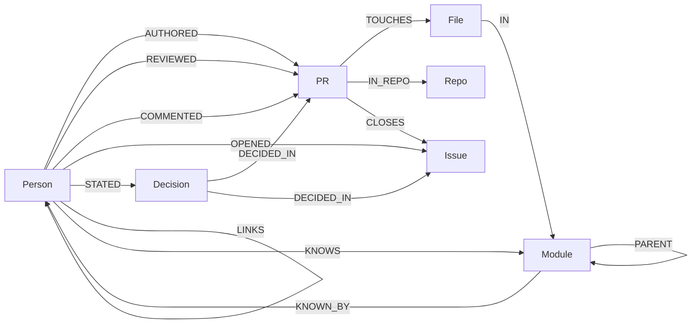

# Keystone

**Who knows what, and why it was decided. Every answer carries its evidence.**

Keystone turns the public history of a codebase (pull requests, reviews, issues, discussions) into a FalkorDB graph, then puts an agent on top that can answer *"who should review this?"*, *"who actually understands this module?"*, *"which modules would lose knowledge if one person left?"* and *"why did we decide that?"*. Each answer shows the subgraph and the exact Cypher behind it, and every quoted decision is checked against its source text by code before it is shown.

Built for **Graph Hacks: Context for AI Agents** (WeMakeDevs x FalkorDB), Oct 15-18 2026.
Tracks entered: **1 Agents That Act on Connected Data, 2 Agent Memory and Coordination, 3 Company Brain**.

* Live demo: _(filled in at deploy time)_
* Demo video: _(filled in at submission)_
* Blog post: _(filled in at submission)_

## Why a graph, and why FalkorDB

The question "who should review this PR" is a multi-hop question: PR -> files -> directories -> every earlier PR in those directories -> the people who authored or reviewed them, weighted by how recently, plus who has reviewed this author before. A similarity search over text cannot answer it; a graph traversal answers it in tens of milliseconds. Remove FalkorDB and the product has nothing to run on: scoring, risk, communities, decision tracing and agent memory are all Cypher or FalkorDB procedures.

| Capability | What FalkorDB does |
|---|---|
| Reviewer and expert scoring | Variable-length traversal over `PARENT*0..3` module hierarchy, `exp()` recency decay, time-travel with `$asof` |
| Knowledge-risk map | Aggregation per module of who touched it in the last 12 months |
| Bridge people, teams | `algo.betweenness`, `algo.labelPropagation`, `algo.pageRank` on the author->reviewer graph |
| "How are A and B connected" | `shortestPath` over `KNOWS / KNOWN_BY / LINKS` |
| Why was it decided | Vector index on `Decision.emb` and `PR.emb`, then graph expansion to sources and people (hybrid retrieval) |
| Per-user memory | One named graph per user (`mem_<user>`), structural isolation |
| Per-tenant knowledge | One named graph per tenant (`kb_<tenant>`) |
| Agent coordination | Task nodes in `ops_<tenant>`, claimed by a single atomic write query |

## Graph data model



* **Source layer** (loaded by `keystone/load.py`, idempotent `MERGE`): `Person, PR, Issue, File, Module, Repo`.
* **Derived layer** (`keystone/derive.py`): `COLLAB` (author -> reviewer, weighted), `KNOWS`/`KNOWN_BY`/`LINKS` (directed on purpose, FalkorDB `shortestPath` is directed-only), and algorithm scores written to `Person` (`pagerank`, `bridge`, `community`).
* **Decision layer** (`keystone/decisions.py`): `Decision {text, why, quote, ts, emb}` linked to its source thread and the person who said it.
* **Memory graphs**: `mem_<user>` holds `Episode`, `Entity`, `FEEDBACK` and `AVOID` rules. **Ops graph** `ops_<tenant>` holds `Task`.

## The Cypher the product depends on

All agent-facing queries live in [`keystone/queries.py`](keystone/queries.py) and [`keystone/tools.py`](keystone/tools.py). The agent never writes Cypher; it calls fixed, parameterised tools, executed with `GRAPH.RO_QUERY` and a timeout, so the server rejects any write.

Reviewer signal from the module hierarchy (walk up from each touched module, then down to everyone who worked under it, nearer ancestors count more):

```cypher
UNWIND $mods AS mid
MATCH up = (m0:Module {id: mid})-[:PARENT*0..2]->(m:Module)
WITH m, min(length(up)) AS k
MATCH (m)<-[:PARENT*0..3]-(:Module)<-[:IN]-(:File)<-[:TOUCHES]-(pr:PR)<-[r:AUTHORED|REVIEWED]-(p:Person)
WHERE pr.createdAt < $asof AND p.login <> $author
RETURN p.login, sum((CASE type(r) WHEN 'REVIEWED' THEN $wr ELSE $wa END) * exp(-($asof - pr.createdAt) / $tau) / (1.0 + k)) AS s
```

Topic expertise (hybrid: enter by meaning, expand by structure):

```cypher
CALL db.idx.vector.queryNodes('PR','emb',40,vecf32($v)) YIELD node, score
MATCH (p:Person)-[r:AUTHORED|REVIEWED]->(node)
RETURN p.login, sum((1.0 - score) * (CASE type(r) WHEN 'REVIEWED' THEN 1.0 ELSE 0.6 END) * exp(-($now - node.createdAt) / $tau)) AS s
```

Algorithms on the people graph:

```cypher
CALL algo.pageRank('Person','COLLAB') YIELD node, score SET node.pagerank = score
CALL algo.betweenness({nodeLabels:['Person'], relationshipTypes:['COLLAB'], samplingSize:200, samplingSeed:7}) YIELD node, score SET node.bridge = score
CALL algo.labelPropagation({nodeLabels:['Person'], relationshipTypes:['COLLAB'], maxIterations:10}) YIELD node, communityId SET node.community = communityId
```

Atomic claim for two-agent handoff (one write query; FalkorDB serialises writes, so racing workers cannot double-claim, see `tests/test_coord.py`):

```cypher
MATCH (t:Task {status:'queued'}) WITH t ORDER BY t.prio DESC, t.id LIMIT 1
SET t.status='claimed', t.by=$w, t.claimedAt=$now RETURN t.id
```

## Does it work? A held-out evaluation

Task: for each merged PR in a later time window, predict who actually reviewed it using **only history before that PR was opened** (`$asof`). Weights are tuned on a separate validation slice; the test slice is untouched. Reproduce with `python -m keystone.evaluate <repos>`.

_(final table inserted at the end of the build)_

## The agent

`keystone/agent.py` is a bounded tool-calling loop (OpenAI `gpt-4o-mini`). Design choices worth knowing:

* **The model never writes Cypher and never sees the database.** It chooses among seven fixed tools and explains their output. User identity for memory comes from the session, never from model arguments.
* **Every answer is traceable.** The API returns the tool calls, the exact Cypher executed with row counts and timings, and the evidence subgraph; the UI shows all three.
* **Decisions are verified, not trusted.** The LLM proposes decisions with a quote. Code keeps a decision only if (1) the quote is a verbatim substring of the cited message and (2) a second check confirms the quote states the decision rather than asking about it. Roughly three in ten proposals are rejected.
* **Memory changes behaviour.** Rejecting a suggested reviewer creates a scoped, expiring `AVOID` rule in your own graph; the next suggestion for that subtree skips them and the agent tells you why.
* **Knowledge risk is about modules, not people.** Only public GitHub handles are used; no emails or private data.

## Run it

Requirements: Docker, Python 3.12, an OpenAI key, a GitHub token (read-only, public repos).

```bash
cp .env.example .env            # fill OPENAI_API_KEY, GITHUB_TOKEN (FALKORDB_* only for Cloud)
docker run -d --name keystone-falkor -p 6379:6379 -v keystone_falkor_data:/var/lib/falkordb/data falkordb/falkordb:latest
python -m venv .venv && .venv/Scripts/pip install -r requirements.txt   # or .venv/bin/pip on Linux/macOS
python -m keystone.build_tenant falkordb FalkorDB/GraphRAG-SDK FalkorDB/falkordb-py   # any public repos work
uvicorn keystone.api:app --port 8000   # open http://localhost:8000
```

`build_tenant` is the whole pipeline: fetch (cached, resumable) -> idempotent load -> derive algorithms -> embed -> extract and verify decisions. Point it at any public repositories to get a new, isolated tenant graph.

Tests: `PYTHONPATH=. pytest -q tests` (unit tests, tenant-id validation, and a concurrency test that races 12 threads for 30 tasks and asserts each is claimed exactly once).

## What it deliberately does not do

* It does not judge people. Risk is computed per module; names appear only as the public GitHub handle holding the history.
* It does not claim live GitHub writes: the executor is a dry run unless `GITHUB_WRITE_TOKEN` is set **and** the repo is in `KEYSTONE_WRITE_REPOS`.
* Free-tier FalkorDB Cloud connects without TLS; only public data is stored there.
* Reviewer prediction measures who *did* review, which is not always who *should* have. It is a strong proxy, not ground truth.

## AI-usage disclosure

This project was built with Claude Code (Anthropic) as the coding assistant, directed and verified by the team. The team is responsible for the architecture, graph model, queries, security and correctness, and can explain each of them. The runtime agent uses OpenAI `gpt-4o-mini` and `text-embedding-3-small`.

## Data and licences

Public GitHub metadata and discussion text from public repositories (FalkorDB organisation repositories; `pallets/click` and `pallets/flask` as a second tenant). Short quotes are shown with links to their source. No private, login-protected or personal data is loaded.
